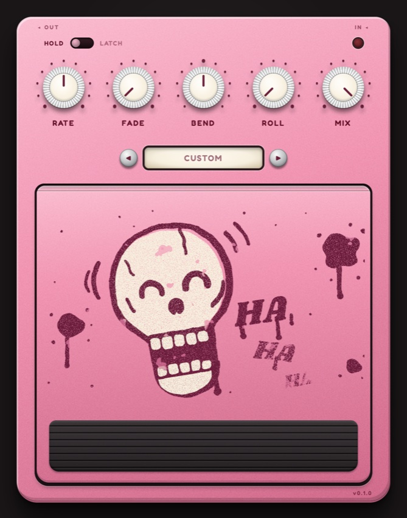

# Ha Ha Ha



A tempo-synced repeater pedal, as a VST3 and CLAP plugin for macOS and
Windows. Hold the treadle and it grabs the last beat division you played
and stutters it on the grid, locked to your host's tempo. Let go and
you're back to dry.

It's built footswitch-first for playing live, and every control can be
automated in the studio.

## How it works

1. It's always listening, keeping the last few seconds of what you play.
2. When the host is playing, stomping grabs a slice starting at the last
   grid line for the current Rate, so a late stomp still lands on the
   grid. The slice repeats in time with the grid: you hear yourself live
   until the slice is captured, then it repeats from the next grid line.
3. With the transport stopped, the slice starts when you stomp and Rate
   uses the host's tempo, or 120 BPM if there isn't one (a quarter note
   is 500 ms).
4. Changing Rate mid-burst takes effect at the next repeat. A longer
   Rate reaches back into audio that's already captured, so it stays on
   the grid.
5. Each repeat's attack lands on the grid whole: the 5 ms before it
   crossfades out of the previous pass. Releasing crossfades back to dry
   in 10 ms.

## Controls

| Control | Range | What it does |
|---|---|---|
| Rate | 1 bar to 1/32, with triplets | How long each repeated slice is |
| Fade | 0–100% | Each repeat gets quieter, by up to 12 dB a repeat |
| Bend | −100–100% | Left slows the repeats into a tape stop, right speeds them up into a riser. Pitch and speed move together, like tape |
| Roll | 0–100% | Each repeat gets shorter, down to half the last one at 100% (1/8, 1/16, 1/32…) |
| Mix | 0–100% | Live signal against repeats. At 50% both are at full level; at 100% the live signal is cut while repeating |
| Trigger | Hold / Latch | Hold repeats while the treadle is down. Latch starts on one tap and stops on the next |
| Repeat | On / Off | The treadle. Map it to a footswitch or automate it |

Fade, Bend and Roll build up from the first repeat. Pressing the
treadle again while it's repeating grabs a fresh slice and starts them
over. Bend gives up the grid: a tape stop drags behind the beat and a
riser runs ahead of it.
For automation, use Hold: in Latch, each press toggles.

Click and hold the treadle to repeat (Space or Enter works too when
it's focused). It sinks and the LED lights while it's repeating, in
Latch as well. Drag a knob up or down (hold Shift for fine moves),
scroll, or use the arrow keys. Double-click to reset.

## Presets

The ◀ ▶ buttons step through eight presets. Loading one sets the knobs
and leaves Trigger alone, and the host records it like any other
control change. The window shows the preset's name while the knobs
match it, and Custom once you change something.

| Preset | Rate | Fade | Bend | Roll | Mix |
|---|---|---|---|---|---|
| Stutter | 1/16 | 0 | 0 | 0 | 100 |
| Roll | 1/8 | 0 | 0 | 60 | 100 |
| Tape stop | 1/4 | 0 | −55 | 0 | 100 |
| Riser | 1/4 | 0 | 45 | 40 | 100 |
| Glitch | 1/16T | 10 | 0 | 30 | 100 |
| Wind down | 1/2 | 20 | −30 | 20 | 100 |
| Dub echo | 1/8T | 25 | 0 | 0 | 50 |
| Big loop | 1 bar | 0 | 0 | 0 | 100 |

## Installing

Download the zip from
[Releases](https://github.com/starzonmyarmz/hahaha/releases) and follow
`INSTALL.txt` inside it.

## Building

```sh
cargo xtask bundle hahaha --release        # target/bundled/Ha Ha Ha.{vst3,clap}
scripts/install.sh                         # bundle, sign ad hoc and install on macOS
scripts/clap-validator.sh "target/bundled/Ha Ha Ha.clap"
```

## Tests

`cargo test` runs the engine offline, in host-sized blocks, against
stored golden renders and synthetic checks. After an intended change to
the sound, rerun with `BLESS=1` to rewrite the renders, and listen to
them before committing.

## Working on the UI

The editor is a webview showing `ui/index.html`, which is compiled into
the plugin. Without the plugin, the page runs against a mock, so you can
work on it in a browser:

```sh
cd ui && python3 -m http.server 8765    # open http://127.0.0.1:8765
```

Add `?version=1.2.0` to show a version other than `0.0.0`. To load
the page live in the plugin, set `HAHAHA_UI_URL` to that URL
before starting the host.

## CI and releases

- `check.yml` runs on pushes to main and on PRs: the tests and
  clap-validator on macOS, and clap-validator on the Windows build.
- `release.yml` runs on `vX.Y.Z` tags. The tag must match `version` in
  the root `Cargo.toml`. It builds a universal macOS bundle and a
  Windows bundle, validates both, and publishes `hahaha-X.Y.Z.zip`
  with `INSTALL.txt`.
- `screenshot.yml` runs on pushes to main that touch `ui/`, the version
  or `plugin/src/lib.rs`. It retakes `docs/hahaha.jpg` with
  `scripts/screenshot.sh`, sets its width in the README, and commits both
  if the image changed.

## Built with

- [nice-plug](https://codeberg.org/RustAudio/nice-plug), pinned to
  [a fork](https://github.com/starzonmyarmz/nice-plug/tree/patina) that
  adds `ActivateContext::gui_context()`.
- [Shrikhand](https://fonts.google.com/specimen/Shrikhand) by Jonny
  Pinhorn and [Fredoka](https://fonts.google.com/specimen/Fredoka) by
  the Fredoka Project Authors, under the SIL Open Font License
  (`ui/fonts`).
- Started from
  [plugin-template](https://github.com/starzonmyarmz/plugin-template).
